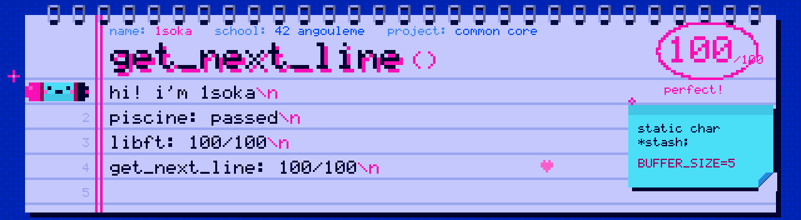

<p align="center"></p>

<div align="center">

# 📄 get_next_line — 42 Angoulême


<br>


</div>

## 📖 About

**get_next_line** is a project of the 42 common core. The goal is to write a function that returns **one line at a time** from a file descriptor, each time it is called, whatever the size of the buffer used to read it.

It is the first project where I had to use a **static variable** to keep data between two calls, and to manage memory very carefully so that nothing leaks. Every function follows the **Norminette**, and the whole project was checked by **Moulinette** and by peer evaluations.

---

## 📝 Result

<div align="center">
<table>
  <tr>
    <th>get_next_line</th>
  </tr>
  <tr>
    <td align="center"></td>
  </tr>
</table>
</div>

---

## 🔧 Prototype

```c
char	*get_next_line(int fd);
```

| Return value | When |
|---|---|
| The line read, `\n` included | A line was found in the file |
| The last line, without `\n` | The file does not end with a newline |
| `NULL` | Nothing left to read, or an error occurred |

## 🧠 How it works

| Step | What happens |
|:---:|---|
| 1 | `read()` fills a buffer with up to `BUFFER_SIZE` bytes from the file descriptor. |
| 2 | The buffer is appended to a `static` stash that survives between calls. |
| 3 | Steps 1 and 2 repeat until the stash contains a `\n` or `read()` reaches the end of the file. |
| 4 | The line, up to and including the `\n`, is extracted from the stash and returned. |
| 5 | Whatever comes after the `\n` stays in the stash, ready for the next call. |
| 6 | Once everything has been returned, the stash is freed and the function returns `NULL`. |

## 📦 Files

| File | Description |
|---|---|
| `get_next_line.c` | The main logic: reading into the buffer, filling the stash and extracting the line. |
| `get_next_line_utils.c` | Helper string functions used by `get_next_line`. |
| `get_next_line.h` | Prototypes, includes and a default `BUFFER_SIZE`. |

---

## ⚙️ Usage

Compile with the buffer size of your choice:

```bash
cc -Wall -Wextra -Werror -D BUFFER_SIZE=42 get_next_line.c get_next_line_utils.c main.c
```

Read a whole file line by line:

```c
#include <fcntl.h>
#include <stdio.h>
#include <stdlib.h>
#include "get_next_line.h"

int	main(void)
{
	int		fd;
	char	*line;

	fd = open("file.txt", O_RDONLY);
	line = get_next_line(fd);
	while (line)
	{
		printf("%s", line);
		free(line);
		line = get_next_line(fd);
	}
	close(fd);
	return (0);
}
```

---

## 🗂️ Repository structure

```
get_next_line/
├── get_next_line.c         # Read, stash and extract the line
├── get_next_line_utils.c   # Helper string functions
├── get_next_line.h         # Prototypes and default BUFFER_SIZE
└── assets/                 # Banner + grade badge used in this README
```

---

## 🏆 Final words

A big thank you to everyone at 42 Angoulême who tested my function with every `BUFFER_SIZE` they could think of, from 1 to 10 million, and who helped me hunt down the last leaks. This project finally made static variables and `read()` click for me. I came out of it **boosted**, and I really enjoyed it. 💗

<div align="center">

**Made with ☕, 💗 and a lot of segfaults by [1soka](https://github.com/1soka)**

</div>
